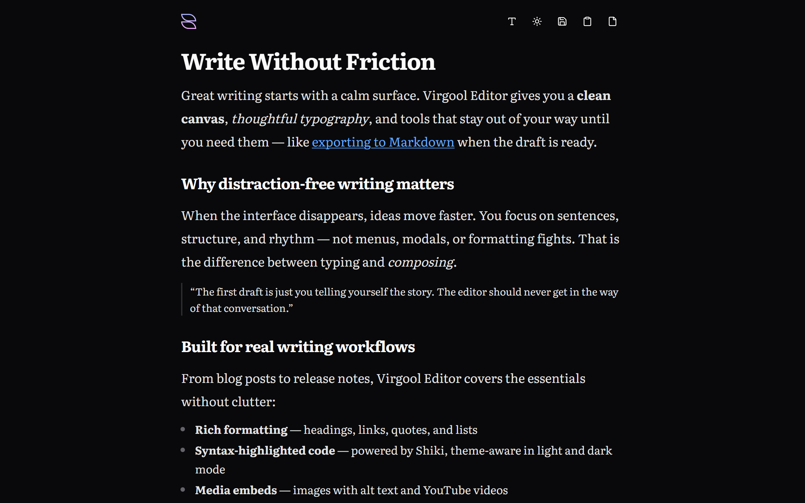

# Virgool Editor

[](LICENSE)
[](https://react.dev/)
[](https://tiptap.dev/)
[](https://www.typescriptlang.org/)
[](https://vite.dev/)

> Virgool (Persian: ویرگول, from French virgule) is the comma ، — a pause between thoughts, inspiring a distraction-free space where ideas flow naturally and writing finds its rhythm.

Virgool Editor is a local-first writing tool with rich formatting, syntax-highlighted code blocks, and one-click export to Markdown, HTML, or JSON. Auto-save keeps your draft in the browser—no account required.

<!-- ## Preview



**[Try the live demo →](https://thisisrexa.github.io/virgool-editor/)** -->

## Features

### Writing & formatting

- Bubble menu: **bold**, _italic_, headings (H1–H3), and links
- Floating menu: images (URL + alt text), YouTube embeds, code blocks with Shiki syntax highlighting, blockquotes, bullet and ordered lists

### Export & clipboard

- Copy as Text, Markdown, HTML, or JSON
- Export to file: Text, Markdown, or HTML
- Import and save JSON documents

### Persistence

- Optional auto-save to `localStorage` (toggle in the Document menu)

### Appearance

- Light and dark theme
- Writing font picker with Google Fonts (serif, sans, mono, and RTL-friendly fonts such as Vazirmatn)

## Tech stack

| Layer | Technologies |
| --- | --- |
| **UI** | React, Tailwind CSS, Shadcn UI |
| **Editor** | Tiptap, Shiki, Turndown |
| **State** | Zustand |
| **Tooling** | Vite, TypeScript, ESLint, Prettier, pnpm |

## Getting started

### Prerequisites

- [Node.js](https://nodejs.org/) 18+
- [pnpm](https://pnpm.io/)

### Installation

```bash
git clone https://github.com/thisisrexa/virgool-editor.git
cd virgool-editor
pnpm install
pnpm dev
```

### Build

```bash
pnpm build
pnpm preview
```

### Lint & format

```bash
pnpm lint
pnpm format
```

## Scripts

| Command | Description |
| --- | --- |
| `pnpm dev` | Start the development server |
| `pnpm build` | Typecheck and create a production build |
| `pnpm preview` | Preview the production build locally |
| `pnpm lint` | Run ESLint |
| `pnpm format` | Format code with Prettier |

## Roadmap

- [ ] Keyboard shortcuts reference
- [ ] Customizable themes

## Contributing

Contributions are welcome. Fork the repo, create a branch, and open a pull request. For bugs or feature ideas, [open an issue](https://github.com/thisisrexa/virgool-editor/issues).

## License

[MIT](LICENSE) © Rexa (2024)

## Author

[Rexa](https://github.com/thisisrexa)
